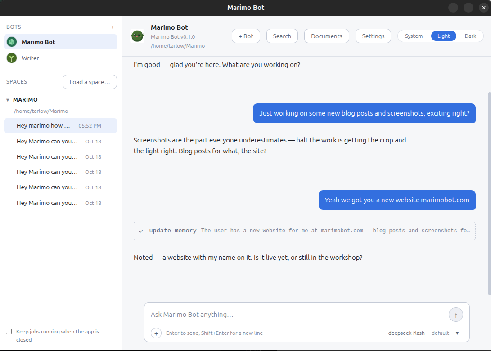

  

<h1 align="center">Marimo Bot</h1>

A desktop AI assistant that works in a folder you choose.

> [!WARNING]
> Marimo Bot is under construction. It changes often, and some changes are breaking. Keep your own copies of anything you care about.

I built Marimo Bot to sit on your computer and work inside a folder you choose. It reads and writes the files there, remembers what matters, and keeps a few helpers, called bots, for work you repeat.

Marimo Bot keeps a conversation's full history and the instructions it was running under, so reopening a chat does not start it over.

The app runs on your computer, not in a browser. There is no account with us. You bring the model: a service you already use, or a llama.cpp server on your own machine.

The chat window and the moss ball share one conversation, so a question you ask from the corner of the screen is waiting in the window when you open it, and the folder you were working in comes back with it.

  

The main window in light mode.

  

A chat with Marimo, and the memory update it made along the way.

## The short version

- Work in a folder, not a chat that forgets where it is.
- Make bots for writing, research, code or whatever you repeat.
- Let one bot ask another for help, with the helper's permissions and approvals kept in the same chat.
- Keep a memory that follows you between folders.
- Let a bot ask for a tool or a change, and decide each request yourself.
- Find a file by what it was about, not the exact words.
- Schedule a job and close the window.
- Ask the moss ball when you do not want the window.

## On this page

- [What it can do](#what-it-can-do)
- [The engine](#the-engine)
- [Bots](#bots)
- [Skills](#skills)
- [Memory](#memory)
- [Learning](#learning)
- [Recall](#recall-find-by-meaning)
- [Jobs](#jobs)
- [The companion](#the-companion)
- [Models and keys](#models-and-keys)
- [Privacy and control](#privacy-and-control)
- [Getting started](#getting-started)
- [Questions](#questions)
- [What is not finished](#what-is-not-finished)
- [Requirements](#requirements)

## What it can do

### The folder you work in

A Space is a folder.

The app can read and write the files in it, and nowhere else. Load a folder and the app files every chat you start there under that Space.

On a fresh install the app creates `Marimo`, inside your home folder, and starts you there. That is a project of its own rather than your whole home directory. Load another folder whenever your work already lives somewhere else.

The work lands in the same place as the rest of your project, so you can open the files with the editor or tools you already use.

### Documents

The Documents drawer lists the files already in the folder, hidden ones included — only the app's own state, `.git`, dependency and build folders stay out. You can edit any UTF-8 text file there, and the bot sees your changes. A binary file such as an image or a PDF is listed too, but the app says it cannot open it as text rather than damaging it. Markdown gets a Preview; everything else is edited as source. If a bot writes a file, it appears in the drawer. Drag the drawer's left edge to make it wider or narrower; the width is remembered. Drag the divider above the editor to give the open file more room; that split is remembered too.

If a file changed while you had it open, the app will not overwrite it. It keeps your draft and asks which version wins. A quiet overwrite would replace the version on disk, and the app cannot know which one you meant to keep.

You can save a chat as a document, with the messages under the author's name. A new file is written straight away; overwriting one asks first.

### Bots

What kind of work do you repeat? A bot is for the work you do again and again.

A bot has its own name, instructions, tools, memory and chats. You can make one for writing, one for research, one for code.

Every bot has a Role and a Persona. The Role is the app's job description: what the bot is for and the rules every bot follows. The Persona is yours: its character, the job in your own words and how you want it to talk to you. The app reads the Persona after the Role, so your words win on tone, but the Persona cannot give a bot a tool it was not given. The tool list is separate, and the operating rules come last. The app can restore the Role, but it will not reset the Persona on its own.

There are three ways to make one.

1. Start from a role. Pick Writer, Marketer, Researcher, Coder, Analyst or Personal assistant. You get a name, a Role, a first Persona and tools. Change the name if you like.
2. Build it step by step. Choose a role or start blank, name it, and pick what it can do.
3. Talk it through with Marimo. Marimo asks what the bot is for, drafts it and shows you a card. Change the name, the starter role or the Persona, then press Create. Nothing is made until you do.

All three end in the same place, so you can pick a starter role when one fits, build it step by step when you want to choose every part, or talk it through with Marimo when you would rather answer questions than fill in a form.

Bots sit at the top of the sidebar, and picking one shows its chats. Settings has its Role, Persona, tools and Space. The icon can be one of five shipped pictures, or one you upload. Drag the sidebar's right edge to widen it; the width is remembered.

Several bots can share a chat, so type `@` to put a question to one of them. Marimo Bot can also hand work to a bot. The helper runs with that bot's tools in the same chat. If it needs permission, the card appears there, and the helper continues after you approve.

Removing a bot asks first. It takes the bot's chats, jobs and memory with it. Files it wrote in your Spaces stay, and the last bot stays too, because something has to answer.

### Skills

A skill is a procedure a bot can pick up and follow: how you like an inbox sorted, how a report should be laid out, how to edit AI-sounding prose.

A skill lives in its own folder as `SKILL.md`, a short note saying what it is for and the steps underneath. The bot sees the name and that one-line note in every conversation, and reads the steps only when a task matches them, so a long procedure does not make every answer slower.

Settings has a **Skills** card. Write one there, or copy a folder into the skills folder in your user-data directory. The switch beside each skill decides which bots may use it.

A bot can also write one. Turn on **save_skill** under what the bot can do, then ask it to remember a way of working, or run **Learn a skill** from the `+` menu after a conversation. It writes the skill, shows you what it is about to save, and switches it on for that bot when you approve.

Settings keeps earlier versions of each skill and lets you restore one. A skill you overwrite is still the user's markdown, so the earlier copies are there when the new wording turns out worse.

### Long conversations

When a chat gets long, the app replaces the earlier part with a summary so the model can keep going, and the conversation keeps every message.

**Compact** in the `+` menu beside the message box does the same when you ask.

### Memory

A fact about you follows you between Spaces, while a note about how a project is set up stays with that project. The app keeps the two apart.

What does it remember? Settings lists every line and when it was written, with a search box and a **Forget** button. If an answer is wrong, choose **Not quite** — the correction is recorded, and the next review turns it into a remembered fact.

A review also reads a conversation after it goes quiet and writes down facts worth keeping. Each one has to be supported by a sentence from the conversation before it is written, so it cannot invent a fact and file it away. You do not approve memories: they appear in Settings, where you can forget any line you do not want.

Memory has a soft limit, so the bot is told when it gets close and can prune what no longer matters. The memory file is plain markdown, so you can read it without the app.

### Learning

The bot can ask to change what it is able to do. It can ask for a tool or a connector it kept needing, or suggest a change to how it runs. None of that happens on its own. Each request waits in **Learning** in Settings, with the reason it gave and the part of the conversation it came from. Remembering a fact is not one of these requests — that is written straight into Memory, as above.

A tool or connector request names the capability and says why the bot needed it. A change to how it runs covers how memory is recalled, how much room a turn has before it is compacted, and how many tool calls a turn may spend. The bot cannot change its Role, its Persona or the app's rules, and it cannot give itself the shell.

If you say no, it remembers the answer for about six months and stops asking. The Learning card lists those refusals and lets you clear them. The bot also looks for work it can do on its own notes: when memory is over the limit you set, it may suggest forgetting the oldest fact; when a skill has not been used in a while, it may suggest retiring it. Both are suggestions, and both wait for you.

### Recall: find by meaning

Use Recall when you remember what a file was about but not the words in it. Press `Ctrl+K`.

It uses EmbeddingGemma 2, a small model with 270 million parameters. The model turns a piece of text into a list of numbers, and the app compares those numbers so a search for the idea can find a file whose exact words you have forgotten. It runs on your processor.

Recall is off until you turn it on. The first time you turn it on, the app downloads the engine and the model it runs. The text model is 310 MB. The part that handles pictures, audio and video is another 555 MB, and you only need it for media search.

What does it search? You choose files, memory, past chats and media. When a Space is loaded, the index, a list of numbers the app can search, stays inside it.

A result shows how close the match is and whether the file has changed since it was indexed. After the download, Recall runs on your machine, so your searches stay local.

### Jobs

What happens while the window is closed? A scheduled job keeps going.

Schedule a task, like a summary every morning. Closing the window does not quit the app. It stays in the tray, the small icon near your clock.

The sidebar has a switch called Keep jobs running when the app is closed. It installs a small background worker so a timer can wake it and run due jobs.

The worker is a small copy of the app that runs due jobs while the window is closed, and it takes turns with the app so the two never write to one chat at the same time.

Then it goes back to sleep until the next job is due. To quit, use the tray menu.

A job runs in its own conversation, with the same tools and approvals as a chat.

### The companion

The moss ball is another way into the same conversation. It floats above your other windows with its own chat bar.

Settings lets you choose how long its answers are, how many messages float above it, whether it stays on top, and whether you can click through it to the window behind.

### The engine

Every conversation runs on the harness: an append-only event log, a frozen instruction and tool spec, and one ADK adapter. The details are in [docs/harness-v2.md](./docs/harness-v2.md).

The **Harness** card in Settings shows what the current bot has recorded: conversations, turns, tokens, suggestions, skills and scheduled jobs. It also lists the instruction and tool versions that bot has used. Restoring one puts back the bot's name, Role, Persona, tools, skills, connectors and model as they were. It leaves the Space, the icon and memory alone.

## Models and keys

No chat model is included, so you choose the service that answers.

- DeepSeek, Google Gemini, OpenCode Go or OpenRouter: an account and an API key. A key is a long password from the service.
- llama.cpp: a program that runs a model on your own machine. Give the app its address. It needs no key, and on your network nothing leaves it.

**Fetch Models** asks the service what it serves. Until you ask, the app lists the names it ships with.

Which model should a bot use? That is yours to decide: a model is a service and a name. The app stores both because the same name can mean different things at different services. A bot can have its own model, and a single chat can use another one.

### Connectors

A connector is a server you add in Settings. It can give a bot tools that live in another app or on another machine: a database, an issue tracker or a service on your network. MCP is the Model Context Protocol, a standard way for a tool server to describe what it can do.

Each bot has its own permissions, and a connector that is not ticked is not offered to that bot. A bot can ask for one it does not have; the request waits in Learning with the reason it gave, and nothing changes until you approve it. The app stores a connector's token or password like a provider key, and the background worker can only use one stored as plain text, with your consent.

### Keys

Keys go in your operating system's password vault, the keychain, when there is one. A background job has no keychain, so the box in setup ("Let scheduled jobs use this key while the app is closed") stores the key as plain text instead. Leave it off unless you need a job to run while the app is closed. A key stored as plain text can be read by anything that can open the file. A machine without a keychain can only store a key as plain text.

## Privacy and control

Where do your words go? The answer depends on the service you chose: a local llama.cpp server keeps them on your machine or your network, while an online service gets them under your account.

The app's other network traffic comes from the things you ask for. A web search sends the query to DuckDuckGo. A connector talks to the server you set up. **Fetch Models** asks the provider what it serves. Recall downloads its engine and model once. **Check for updates** asks GitHub for the latest release only when you press it.

The app keeps its own data in one folder. On Linux that is `~/.config/Marimo Bot`. Your chats, the Spaces you loaded and your settings are there. Keys are in the keychain, except a key you let a background job read, which is in that folder instead.

The app's own data is not your project, and the two live in different folders on purpose. A Space's files stay where you put them.

A command, or a save over a file that already exists, waits for your answer. The app writes a new file without asking. A scheduled job that hits an approval stays paused, and the request survives a restart.

Every built-in tool the app offers is a switch in Settings. If a tool is off, the app does not offer it to the model at all. A connector's tools follow the connector's own switch. Above those switches, Settings also offers the same two choices the first run asks about — Standard and Power user. They set the whole list at once, and every switch stays there to tune afterwards.

Recall is off until you turn it on, and it sends its record nowhere.

Reset Marimo Bot, at the bottom of Settings, erases the app's folder, switches off start-at-login and the job timer, and quits. There is no undo.

## Getting started

There is no public download yet. The Linux version builds to a single AppImage file you can run without installing it. The Windows and macOS installers are written but not built.

If you have the app, the first run is short.

1. Choose how much control Marimo Bot gets. **Standard** can read files in your Space, search the web, and keep its own notes; **Power user** turns on every tool the app has, including writing files, running commands, scheduling jobs and handing work to your other bots. Either way, a command or a replacement of an existing file still asks you first. You can change this later in Settings.
2. Choose a model. Which service should answer? Pick a service, or point the app at a llama.cpp server. An online service needs an account and a key. **Fetch Models** asks it what it serves. Set this up later closes the flow.
3. Choose a Space. Marimo starts you in `Marimo`, a folder it creates inside your home folder. Pick another folder if your work already lives somewhere else. The app can read and write there, and nowhere else. You can skip this.
4. Make a bot. Start from a role, build it step by step or talk to Marimo.
5. Make it yours. Pick an icon, and write its Persona. The starter Persona is there to change or keep. The Role is shown greyed out: it is the app's brief for the bot, it shapes how the bot works with the others, and Settings is where you change it.
6. Add more bots, or finish. Marimo Bot alone works too. Settings is where you make another.

Every step has a Back button, so you can change an earlier answer without starting over.

The control choice comes first because it is about access, and the model is the first required step because the guided bot maker needs something that can answer. The Space comes next because most of what a bot does is easier when it has a folder to work in. The app will not move past the model step until it can answer.

When you finish, the app opens a new chat in the Space you chose, so the first thing you type lands in the folder you meant.

After setup, Settings is one screen, and the bots and Spaces are in the sidebar. The `+` beside Bots makes another bot. `Ctrl+K` opens Recall. The app stays in the tray until you quit it from there.

One bot is enough for most days.

## Questions

### Do I need an account with Marimo Bot?

No, you need an account with the model service you choose, or a llama.cpp server.

### Can I use it without making a bot?

Yes, Marimo Bot is useful on its own, and bots are for work you repeat.

### Does it work offline?

The app, your chats and Recall work without a network, but a chat needs a model, and an online model needs the internet while a llama.cpp server can stay on your own machine or network.

### Do I need a graphics card?

Not for Recall, which runs on the processor. If you run llama.cpp on the same machine, a graphics card helps speed and the model has to fit in its memory, so a bigger model may need more card than you have.

### Where are my files?

Your Space files stay in the folder you chose, and the app's own data is in its data folder, which on Linux is `~/.config/Marimo Bot`.

### What happens when I close the window?

The app stays in the tray and a scheduled job keeps going. You quit from the tray menu when you want it to stop.

### Can I change a bot later?

Yes, Settings has its Role, Persona, tools, model, Space and icon. The Harness card can also restore an earlier version of them.

### Does it send my work anywhere?

Only where you ask it to: an online model receives the conversation you send it, a web search receives the query, and a connector receives what it is asked to do. Recall downloads its engine and model once, then keeps its index and searches on your machine. The update check contacts GitHub only when you press the button.

### What is not finished?

See the next section for the short answer: Windows and macOS installers, automatic updating, and Discord and the notes and to-do tools.

## What is not finished

- The Windows and macOS installers are written but not built. Only the Linux AppImage has been run.
- There is no automatic updater. Settings can check for a newer release and open its notes, but downloading and installing is still a manual step, and releases are not signed yet.
- Discord and the notes and to-do lists are partly built, but nothing in the window turns them on yet.
- The app checks the Recall download against a fingerprint, but there is no signature to prove where it came from. No other model is downloaded.

## Requirements

Will it run on my machine? These are the things it needs.

- A 64-bit version of Linux, Windows or macOS. Linux is the only one with a built installer today.
- About 310 MB for the recall model, 555 MB more for media, plus an index that grows with the folder.
- An account and a key with an online service, if that is what you picked. A llama.cpp server needs no key.
- If you run llama.cpp on this machine, close games and video editors before starting it. The model and the game want the same video memory.

The app carries no chat model, so you can change services without downloading a new one. Recall is the only model the app runs itself, and only after you turn it on.

Go build your next thing with it.

## For developers

The design decisions, the code layout and how to build a release are in [TECHNICAL.md](./TECHNICAL.md). The blunt working notes, including the rules that are easy to break, are in [AGENTS.md](./AGENTS.md).

## Licence

Apache-2.0. See [LICENCE](./LICENCE) and [NOTICE](./NOTICE).
