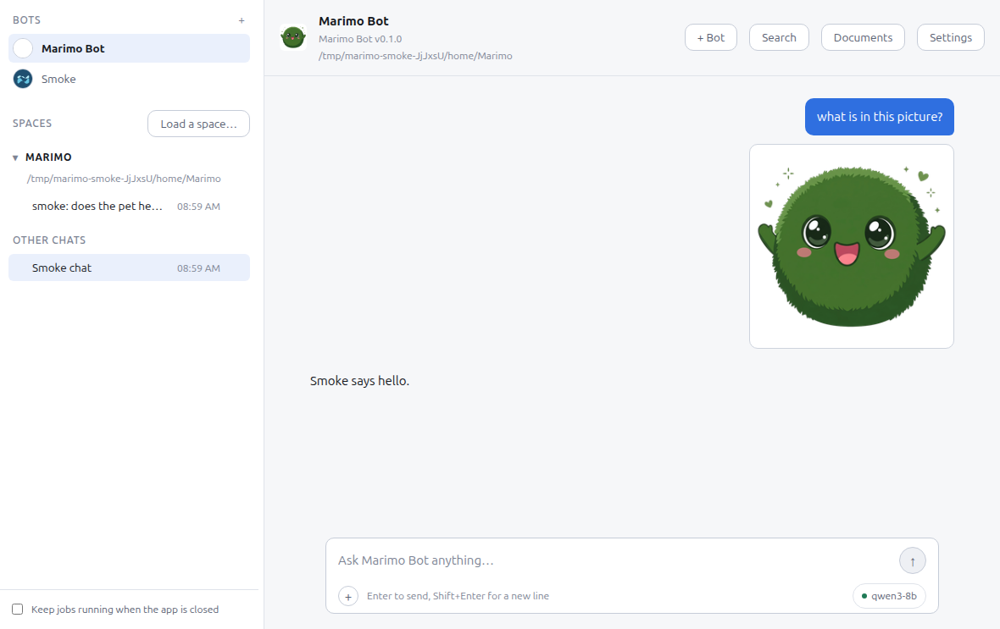
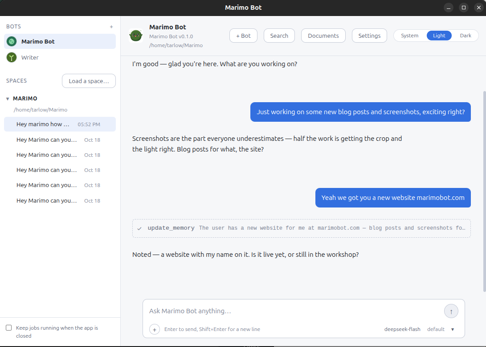

  

<h1 align="center">Marimo Bot</h1>

A desktop AI assistant that works in a folder you choose.

> [!WARNING]
> Marimo Bot is under construction. It changes often, and some changes are breaking. Keep your own copies of anything you care about.

I built Marimo Bot to sit on your computer and work inside a folder you choose. It reads and writes the files there, remembers what matters, and keeps a few helpers, called bots, for work you repeat.

Marimo Bot runs small Liquid AI models on your own machine. There is no account, no API key, and no model service in the middle: the first run downloads the text model, and offers pictures or voice only when you say you want them. After that the app answers on this computer, using the graphics card when it has one. It can search the web and talk to connectors when you ask, but the everyday conversation stays on the computer.

Marimo Bot keeps a conversation's full history and the instructions it was running under, so reopening a chat does not start it over.

The chat window and the moss ball share one conversation, so a question you ask from the corner of the screen is waiting in the window when you open it, and the folder you were working in comes back with it.

  

The main window in light mode.

  

A chat with Marimo, and the memory update it made along the way.

## The short version

- Work in a folder, not a chat that forgets where it is.
- Four small local models: text, pictures, voice and one that does all three.
- Attach a picture and the vision model looks at it.
- Talk instead of typing, and let the answer be spoken.
- Make bots for writing, research, code or whatever you repeat.
- Let one bot ask another for help, with the helper's permissions and approvals kept in the same chat.
- Keep a memory that follows you between folders.
- Let a bot ask for a tool or a change, and decide each request yourself.
- Find a file by what it was about, not the exact words.
- Schedule a job and close the window.
- Ask the moss ball when you do not want the window.

## On this page

- [What it can do](#what-it-can-do)
- [The engine](#the-engine)
- [Bots](#bots)
- [Skills](#skills)
- [Memory](#memory)
- [Learning](#learning)
- [Recall](#recall-find-by-meaning)
- [Jobs](#jobs)
- [The companion](#the-companion)
- [Models](#models)
- [Connectors](#connectors)
- [Privacy and control](#privacy-and-control)
- [Getting started](#getting-started)
- [Questions](#questions)
- [What is not finished](#what-is-not-finished)
- [Requirements](#requirements)

## What it can do

### The folder you work in

A Space is a folder.

The app can read and write the files in it, and nowhere else. Load a folder and the app files every chat you start there under that Space.

On a fresh install the app creates `Marimo`, inside your home folder, and starts you there. That is a project of its own rather than your whole home directory. Load another folder whenever your work already lives somewhere else.

The work lands in the same place as the rest of your project, so you can open the files with the editor or tools you already use.

### Pictures

Attach a picture with the `+` beside the message box. The vision model reads the image itself, so you can ask what is in a screenshot, a diagram or a page you photographed.

The picture is attached to that one message. Attaching it does not copy or index it, and it is not sent anywhere: the vision model runs on this computer. (Recall indexes a Space's media only if you turned media search on.)

### Voice

Turn on **Talk to Marimo** in Settings and the companion answers out loud.

Hold the microphone button to speak, release it, and what you said appears in the message box before it is sent. The app transcribes with the same audio model that speaks the answer, so a voice turn never needs two models loaded at once. The answer is kept short and read as prose: code blocks, tables and links are for the window, not for the ear.

Voice mode uses the audio model for the whole turn, not just the speaking. That keeps one model in memory, and it means a question asked by voice is answered by the voice model. For harder work, use the window without the microphone.

### Documents

The Documents drawer lists the files already in the folder, hidden ones included — only the app's own state, `.git`, dependency and build folders stay out. You can edit any UTF-8 text file there, and the bot sees your changes. A binary file such as an image or a PDF is listed too, but the app says it cannot open it as text rather than damaging it. Markdown gets a Preview; everything else is edited as source. If a bot writes a file, it appears in the drawer. Drag the drawer's left edge to make it wider or narrower; the width is remembered. Drag the divider above the editor to give the open file more room; that split is remembered too.

If a file changed while you had it open, the app will not overwrite it. It keeps your draft and asks which version wins. A quiet overwrite would replace the version on disk, and the app cannot know which one you meant to keep.

You can save a chat as a document, with the messages under the author's name. A new file is written straight away; overwriting one asks first.

### Bots

What kind of work do you repeat? A bot is for the work you do again and again.

A bot has its own name, instructions, tools, memory and chats. You can make one for writing, one for research, one for code.

Every bot has a Role and a Persona. The Role is the app's job description: what the bot is for and the rules every bot follows. The Persona is yours: its character, the job in your own words and how you want it to talk to you. The app reads the Persona after the Role, so your words win on tone, but the Persona cannot give a bot a tool it was not given. The tool list is separate, and the operating rules come last. The app can restore the Role, but it will not reset the Persona on its own.

There are three ways to make one.

1. Start from a role. Pick Writer, Marketer, Researcher, Coder, Analyst or Personal assistant. You get a name, a Role, a first Persona and tools. Change the name if you like.
2. Build it step by step. Choose a role or start blank, name it, and pick what it can do.
3. Talk it through with Marimo. Marimo asks what the bot is for, drafts it and shows you a card. Change the name, the starter role or the Persona, then press Create. Nothing is made until you do.

All three end in the same place, so you can pick a starter role when one fits, build it step by step when you want to choose every part, or talk it through with Marimo when you would rather answer questions than fill in a form.

Bots sit at the top of the sidebar, and picking one shows its chats. Settings has its Role, Persona, tools and Space. The icon can be one of five shipped pictures, or one you upload. Drag the sidebar's right edge to widen it; the width is remembered.

Several bots can share a chat, so type `@` to put a question to one of them. Marimo Bot can also hand work to a bot. The helper runs with that bot's tools in the same chat. If it needs permission, the card appears there, and the helper continues after you approve.

Removing a bot asks first. It takes the bot's chats, jobs and memory with it. Files it wrote in your Spaces stay, and the last bot stays too, because something has to answer.

### Skills

A skill is a procedure a bot can pick up and follow: how you like an inbox sorted, how a report should be laid out, how to edit AI-sounding prose.

A skill lives in its own folder as `SKILL.md`, a short note saying what it is for and the steps underneath. The bot sees the name and that one-line note in every conversation, and reads the steps only when a task matches them, so a long procedure does not make every answer slower.

Settings has a **Skills** card. Write one there, or copy a folder into the skills folder in your user-data directory. The switch beside each skill decides which bots may use it.

A bot can also write one. Turn on **save_skill** under what the bot can do, then ask it to remember a way of working, or run **Learn a skill** from the `+` menu after a conversation. It writes the skill, shows you what it is about to save, and switches it on for that bot when you approve.

Settings keeps earlier versions of each skill and lets you restore one. A skill you overwrite is still the user's markdown, so the earlier copies are there when the new wording turns out worse.

### Long conversations

When a chat gets long, the app replaces the earlier part with a summary so the model can keep going, and the conversation keeps every message.

**Compact** in the `+` menu beside the message box does the same when you ask.

A small local model has a smaller working window than a large model. The app keeps the working context under about 24,000 tokens and treats the rest of the conversation as something to summarise or search, rather than sending a request the engine cannot fit.

### Memory

A fact about you follows you between Spaces, while a note about how a project is set up stays with that project. The app keeps the two apart.

What does it remember? Settings lists every line and when it was written, with a search box and a **Forget** button. If an answer is wrong, choose **Not quite** — the correction is recorded, and the next review turns it into a remembered fact.

A review also reads a conversation after it goes quiet and writes down facts worth keeping. Each one has to be supported by a sentence from the conversation before it is written, so it cannot invent a fact and file it away. You do not approve memories: they appear in Settings, where you can forget any line you do not want.

Memory has a soft limit, so the bot is told when it gets close and can prune what no longer matters. The memory file is plain markdown, so you can read it without the app.

### Learning

The bot can ask to change what it is able to do. It can ask for a tool or a connector it kept needing, or suggest a change to how it runs. None of that happens on its own. Each request waits in **Learning** in Settings, with the reason it gave and the part of the conversation it came from. Remembering a fact is not one of these requests — that is written straight into Memory, as above.

A tool or connector request names the capability and says why the bot needed it. A change to how it runs covers how memory is recalled, how much room a turn has before it is compacted, and how many tool calls a turn may spend. The bot cannot change its Role, its Persona or the app's rules, and it cannot give itself the shell.

If you say no, it remembers the answer for about six months and stops asking. The Learning card lists those refusals and lets you clear them. The bot also looks for work it can do on its own notes: when memory is over the limit you set, it may suggest forgetting the oldest fact; when a skill has not been used in a while, it may suggest retiring it. Both are suggestions, and both wait for you.

### Recall: find by meaning

Use Recall when you remember what a file was about but not the words in it. Press `Ctrl+K`.

It uses EmbeddingGemma 2, a small model with 270 million parameters. The model turns a piece of text into a list of numbers, and the app compares those numbers so a search for the idea can find a file whose exact words you have forgotten. It runs on your processor.

Recall is off until you turn it on. The first time you turn it on, the app downloads the engine and the model it runs. The text model is 310 MB. The part that handles pictures, audio and video is another 555 MB, and you only need it for media search.

What does it search? You choose files, memory, past chats and media. When a Space is loaded, the index, a list of numbers the app can search, stays inside it.

A result shows how close the match is and whether the file has changed since it was indexed. After the download, Recall runs on your machine, so your searches stay local.

### Jobs

What happens while the window is closed? A scheduled job keeps going.

Schedule a task, like a summary every morning. Closing the window does not quit the app. It stays in the tray, the small icon near your clock.

The sidebar has a switch called Keep jobs running when the app is closed. It installs a small background worker so a timer can wake it and run due jobs.

The worker is a small copy of the app that runs due jobs while the window is closed, and it takes turns with the app so the two never write to one chat at the same time. It starts the local model for the job and stops it afterwards, because the model is hundreds of megabytes of weights and a spinning fan with no window to explain it.

Then it goes back to sleep until the next job is due. To quit, use the tray menu.

A job runs in its own conversation, with the same tools and approvals as a chat.

### The companion

The moss ball is another way into the same conversation. It floats above your other windows with its own chat bar.

Settings lets you choose how long its answers are, how many messages float above it, whether it stays on top, whether you can click through it to the window behind, and whether it talks.

With **Talk to Marimo** on, the moss has a microphone of its own and speaks the answers it started. The window does not read the same answer a second time: the turn remembers which surface asked.

### The engine

Every conversation runs on the harness: an append-only event log, a frozen instruction and tool spec, and one ADK adapter. The details are in [docs/harness-v2.md](./docs/harness-v2.md).

The **Harness** card in Settings shows what the current bot has recorded: conversations, turns, tokens, suggestions, skills and scheduled jobs. It also lists the instruction and tool versions that bot has used. Restoring one puts back the bot's name, Role, Persona, tools, skills and connectors. It deliberately leaves the model assignment, the Space, the icon and memory alone: the model is an app-wide task choice now, and undoing a choice the person did not make in that dialog would be a surprise.

## Models

No model comes inside the app. The first run downloads the text model from Liquid AI, then every turn runs it on this computer with llama.cpp.

Four models cover the work:

- **LFM3 1.7B** — the everyday text model. About 1.9 GB at Q8, or 1.1 GB at Q4. This is the one the first run always downloads.
- **LFM3 VL 2B** — the vision model, for pictures. Q8 uses the same 1.9 GB of weights plus a 203 MB projector; Q4 is about 1.1 GB plus that projector.
- **LFM3 Audio 2B** — listens and speaks, in 18 languages. About 1.1 GB at Q4 plus a 172 MB projector.
- **LFM3 Omni 2B** — text, pictures, audio and video in one set of weights. About 1.1 GB at Q4 plus a 507 MB projector.

**Models** in Settings decides which model does which task: Chat, Images and Voice. The three are separate because a laptop that can spare 2 GB for text may not want to keep a vision model in memory all day. A visual or voice question switches models for that turn, and switching back is another load.

One model is in memory at a time. The app starts the one the turn needs, and after three quiet minutes it lets it go, so a chat you finished does not keep a fan running. **Sleep now** does it immediately; the next message wakes the model again. The composer's badge shows which family is warm: a dot for awake, waking or resting. Clicking it opens the Models card.

Each model has a Q8 copy and a Q4 copy where the repository publishes one. Q8 is the better answer and the larger download; Q4 is for a machine with less memory. The app measures the machine's RAM and suggests the smaller copy below 8 GB. A 4-bit projector is not published for the vision model, so its Q4 copy uses the Q8 projector; the download card says so.

**Use one model for everything (Omni)** is a single button for a machine that would rather load once. It points all three tasks at the Omni model.

The first run always downloads the text model. If you choose **Look at pictures** or **Talk out loud** in the setup goals, it also offers the matching vision or audio model as an optional download in the same flow; you can skip it there and add it later in Settings. The omni model is a Settings choice. A download starts only when you press Download, and the app does not fetch a model in the background.

The files live under the app's folder: on Linux, `~/.config/Marimo Bot/model/`. Settings shows each model, its installed copy and its size, and **Remove…** deletes only that model's directory. Removing the model a task is using is allowed only when nothing is running, and the next message in that task then shows the download card instead of failing with a half-loaded engine.

The models are licensed by Liquid AI under the [LFM Open License v1.0](https://huggingface.co/LiquidAI/LFM3-1.7B-GGUF/blob/main/LICENSE). They are downloaded from Hugging Face at a pinned revision, and every file is checked against a pinned digest before it is used. Nothing is uploaded.

### Connectors

A connector is a server you add in Settings. It can give a bot tools that live in another app or on another machine: a database, an issue tracker or a service on your network. MCP is the Model Context Protocol, a standard way for a tool server to describe what it can do.

Each bot has its own permissions, and a connector that is not ticked is not offered to that bot. A bot can ask for one it does not have; the request waits in Learning with the reason it gave, and nothing changes until you approve it. A connector's token or password is stored like any other secret, and the background worker can only use one stored as plain text, with your consent.

## Privacy and control

Your conversations, files and memory stay on this computer. The model, the speech recogniser and the speech synthesiser are local; a recording is turned into a WAV in memory, sent to the local engine, and never written to disk by the app.

The app reaches the network only for things you ask for:

- The first model download, and any later model download, come from Hugging Face.
- A web search sends the query to DuckDuckGo.
- A connector talks to the server you set up.
- Recall downloads its engine and model once.
- **Check for updates** asks GitHub for the latest release only when you press it.

The app keeps its own data in one folder. On Linux that is `~/.config/Marimo Bot`. Your chats, the Spaces you loaded, the models and your settings are there. A connector's secret is in the keychain, except one you let a background job read, which is in that folder instead.

The app's own data is not your project, and the two live in different folders on purpose. A Space's files stay where you put them.

A command, or a save over a file that already exists, waits for your answer. The app writes a new file without asking. A scheduled job that hits an approval stays paused, and the request survives a restart.

Every built-in tool the app offers is a switch in Settings. If a tool is off, the app does not offer it to the model at all. A connector's tools follow the connector's own switch. Above those switches, Settings also offers the same two grants the first run writes — **Standard** and **Power user**. The first run frames them as Regular and Power setup; either way they set the whole list at once, and every switch stays there to tune afterwards.

Recall is off until you turn it on, and it sends its record nowhere.

Reset Marimo Bot, at the bottom of Settings, erases the app's folder, switches off start-at-login and the job timer, and quits. It does not delete a Space, and it does not delete the downloaded models if they live outside the app's folder. There is no undo for the rest.

## Getting started

There is no public download yet. The Linux version builds to a single AppImage file you can run without installing it. The Windows and macOS installers are written but not built.

If you have the app, the first run asks a few questions and then shows only the steps those answers call for.

1. **Choose a setup style.** **Regular** gives Marimo Bot the Standard tools and keeps the path short. **Power** gives it every tool the app has — writing files, running commands, scheduling jobs and handing work to your other bots — and opens the extra steps, including the jobs step when you choose scheduling. Where a tool can act, a command or a replacement of an existing file still asks you first. You can change this later in Settings.
2. **Say what you want to do.** Pick any of: use your files, research the web, write and edit, work on code, build a team of bots, look at pictures, talk out loud, or run jobs on a schedule. These choose which steps appear and which starter bot is suggested. They do not give Marimo Bot any tools. Scheduling is part of Power setup; the other goals are available either way, and choosing a writing or coding goal suggests a bot with its own tools.
3. **Download the text model.** The app offers **LFM3 1.7B** at Q8 (about 1.9 GB) or Q4 (about 1.1 GB). This is the only required step. The download runs in the window and can be cancelled. **Set this up later** closes the flow; Settings → Models is where to download it afterwards. Once the files are in place, **Check it loads now** starts the engine once; the first message would do the same, so this is a way to watch it rather than a second requirement.
4. **Pictures and voice, if you asked for them.** The flow offers the assigned vision or audio model as a separate, optional download. You can skip it here and add it later in Settings → Models. If the voice model is installed, the step also offers **Talk to Marimo**, which turns on the microphone and spoken answers.
5. **Choose a Space.** Marimo starts you in `Marimo`, a folder it creates inside your home folder. Pick another folder if your work already lives somewhere else. The app can read and write there, and nowhere else. You can skip this.
6. **Make a bot, if a goal calls for one.** Start from the suggested role, build it step by step or talk it through with Marimo. Some goals — files, pictures, voice on their own — do not need a bot and skip this step; the `+` beside Bots makes one later.
7. **Make it yours.** Pick an icon, and write its Persona. The starter Persona is there to change or keep. The Role is shown greyed out: it is the app's brief for the bot, it shapes how the bot works with the others, and Settings is where you change it.
8. **Add more bots, or move on.**
9. **Jobs, if Power and scheduling were chosen.** Turn on the background service so jobs keep running when the window is closed. A job that hits an approval stays paused. This is optional, and the same switch is in the Jobs rail.
10. **Review and start.** The last step says what was actually configured: the model, the Space, the bots, and any pictures, voice or jobs. Then it opens a new chat in the Space you picked, or leaves you in the chat the starting folder already had if you kept it.

Every step has a Back button, so you can change an earlier answer without starting over.

The setup style comes first because it is about access. The goals come next because they are what make the flow shorter for someone who only wants to chat and longer for someone who wants pictures, voice, bots or scheduled work. The text model is the one required step because the app cannot answer without it; the rest is optional and can be changed afterwards.

When you finish, the app opens a new chat in the Space you picked, so the first thing you type lands in the folder you meant. If you kept the folder the app started in, it stays in the chat it already opened.

After setup, Settings is one screen, and the bots and Spaces are in the sidebar. The `+` beside Bots makes another bot. `Ctrl+K` opens Recall. The app stays in the tray until you quit it from there.

One bot is enough for most days.

## Questions

### Do I need an account?

No. The models run on this computer, and there is no account with us or with a model service. The first download comes from Hugging Face, which does not need a login for these files.

### How big is the download?

About 1.9 GB for the Q8 text model, or 1.1 GB for Q4. That is the one the first run always downloads. If you choose pictures or voice in the setup goals, it also offers the vision or audio model as an optional download, between about 1.2 GB and 2.4 GB. The omni model and later downloads are in Settings.

### Can I use it without making a bot?

Yes. Marimo Bot is useful on its own, and bots are for work you repeat. The setup only offers the bot step when a goal asks for one; the `+` beside Bots makes one later.

### Are my voice recordings saved?

No. The microphone is captured in memory, turned into a WAV for the local engine and discarded; the app stores the transcript, which is the message you can edit before sending. The answer is stored as text too, not as audio.

### Does it work offline?

Yes, once the model you want is downloaded. The first download, a web search, a connector and the update check need a network; a conversation, the memory, Recall and voice do not.

### Do I need a graphics card?

No, but it uses one when it can. The default engine is a Vulkan build on Linux and Windows, and a Metal build on macOS. With a card it offloads every layer — a 12 GB card such as a GeForce RTX 3060 holds any of the four models, their projectors and the 32K context together. A machine without a usable GPU runs the same engine on its processor, so the app is slower rather than broken.

On an NVIDIA card, **Settings → Models** also offers a CUDA engine. It is usually faster than Vulkan, and it is opt-in because the engine and the CUDA runtime are about 776 MB on Linux or 671 MB on Windows, against 35 MB for Vulkan. It needs NVIDIA driver 570.65 or newer on Linux, or 550.54 or newer on Windows; the switch is only shown when `nvidia-smi` reports a driver that can run it. Switching back to Vulkan downloads the smaller engine again.

Recall's embedding model is the one exception: it stays on the processor because its model card warns that the activations can overflow float16 on a GPU.

### How much memory does it need?

About 2.5 GB of graphics memory while a Q8 text model is loaded and offloaded, or 1.6 GB for Q4; on a machine with no GPU the same amount comes from system memory. The vision and audio models have projectors on top. The app lets the model go after three quiet minutes, so the memory comes back.

### Where are my files?

Your Space files stay in the folder you chose. The app's own data is in its data folder, which on Linux is `~/.config/Marimo Bot`. The models are under `model/` inside that folder unless `MARIMO_MODEL_DIR` points somewhere else.

### What happens when I close the window?

The app stays in the tray and a scheduled job keeps going. You quit from the tray menu when you want it to stop.

### Can I change a bot later?

Yes, Settings has its Role, Persona, tools, Space and icon. The Harness card can also restore an earlier version of them.

### Does it send my work anywhere?

Only where you ask it to: a web search receives the query, and a connector receives what it is asked to do. The model, the speech recogniser and the speech synthesiser run here. The first model download and Recall's download contact Hugging Face; the update check contacts GitHub only when you press the button.

### What is not finished?

See the next section for the short answer: Windows and macOS installers, automatic updating, and Discord and the notes and to-do tools.

## What is not finished

- The Windows and macOS installers are written but not built. The model downloads and the engine run on all three, but only the Linux AppImage has been run end to end.
- There is no automatic updater. Settings can check for a newer release and open its notes, but downloading and installing is still a manual step, and releases are not signed yet.
- The default engine is a Vulkan build on Linux and Windows, and a Metal build on macOS. It offloads every layer when it finds a device and falls back to the processor when it does not. NVIDIA users can switch to the CUDA build in Settings → Models; it is faster, but it adds about 776 MB on Linux or 671 MB on Windows and is tied to the driver versions above. The switch is opt-in rather than automatic so a laptop does not spend that download by default.
- Voice mode is one microphone press and one spoken answer, not a hands-free conversation. There is no wake word and no barge-in.
- Discord and the notes and to-do lists are partly built, but nothing in the window turns them on yet.
- The app checks every model download against a fingerprint, but there is no signature to prove where it came from.

## Requirements

Will it run on my machine? These are the things it needs.

- A 64-bit Linux, Windows or macOS machine. Linux is the only one with a built installer today.
- About 2 GB of free disk for the text model, and up to 2.4 GB more for each of the others you choose. Recall adds about 310 MB, or 865 MB with media. The default engine adds about 35 MB; choosing CUDA adds about 776 MB of downloads on Linux (671 MB on Windows), or about 1 GB once unpacked.
- About 3 GB of free graphics or system memory while a Q8 model is loaded. Less for Q4.
- No account and no key. A graphics card is not required; the engine falls back to the processor without one, and CUDA is an option only where NVIDIA reports a compatible driver.

The app carries no hosted service. Everything it needs to answer is one of the four local models, downloaded once and checked against a pinned digest.

Go build your next thing with it.

## For developers

The design decisions, the code layout and how to build a release are in [TECHNICAL.md](./TECHNICAL.md). The blunt working notes, including the rules that are easy to break, are in [AGENTS.md](./AGENTS.md).

## Licence

Apache-2.0. See [LICENCE](./LICENCE) and [NOTICE](./NOTICE).
